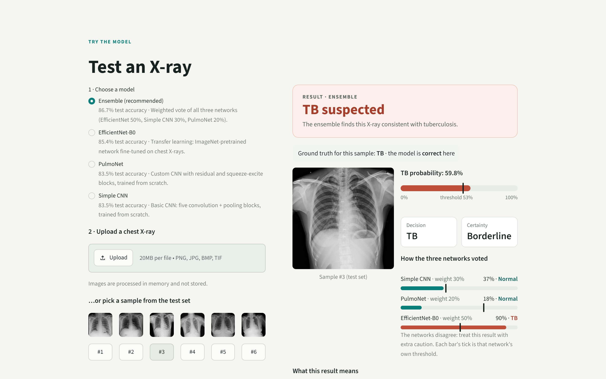
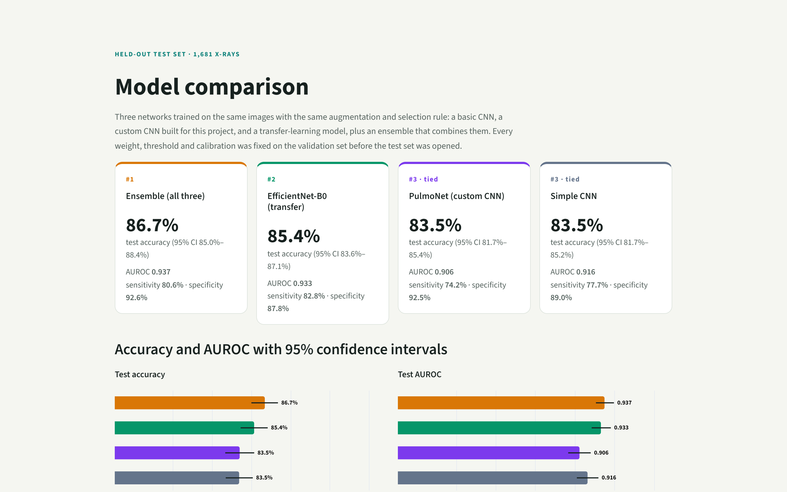

# PulmoSight 🫁

**Deep learning that reads chest X-rays for signs of tuberculosis.**

PulmoSight classifies a frontal chest X-ray as **TB** or **Normal** and returns a calibrated probability.
It compares three convolutional neural networks (a basic CNN, a custom CNN built for this project, and an
ImageNet transfer-learning model) and combines them into an ensemble that beats each of them on held-out data.
A Streamlit app lets anyone test the models on their own X-ray.

> ⚠️ Research and portfolio project. **Not a medical device and not a diagnosis.**

🎬 **Trailer:** [`assets/trailer/PulmoSight_trailer.mp4`](assets/trailer/PulmoSight_trailer.mp4) (46 s, with sound). It also plays on the app's home page.

| Test an X-ray | Model comparison |
|---|---|
|  |  |

---

## Results

All models were trained on the same **13,445** X-rays and scored once on **1,681** test X-rays they never saw.
Calibration, thresholds and ensemble weights were fixed on the **1,659**-image validation set before the test set was opened.

| Rank | Model | Test accuracy [95% CI] | AUROC | Sensitivity | Specificity | Params |
|:-:|---|:-:|:-:|:-:|:-:|:-:|
| 🥇 | **Ensemble** (weighted vote of all three) | **86.7%** [85.0–88.4] | **0.937** | 80.6% | 92.6% | 8.5 M |
| 🥈 | **EfficientNet-B0**: ImageNet transfer learning | 85.4% [83.6–87.1] | 0.933 | 82.8% | 87.8% | 4.0 M |
| 🥉 | **PulmoNet**: custom residual + squeeze-excite CNN | 83.5% [81.7–85.4] | 0.906 | 74.2% | 92.5% | 4.1 M |
| 🥉 | **Simple CNN**: 5 plain conv → pool blocks | 83.5% [81.7–85.2] | 0.916 | 77.7% | 89.0% | 0.39 M |

**What the experiments show**

1. **A basic CNN gets surprisingly far.** The Simple CNN ties PulmoNet (McNemar p = 1.0, DeLong p = 0.08) with 10× fewer parameters.
2. **Transfer learning is the strongest single model.** EfficientNet-B0 beats both from-scratch networks significantly
   (DeLong p = 0.001 vs the Simple CNN and 5×10⁻⁷ vs PulmoNet; McNemar p = 0.035 for both), in the fewest epochs.
3. **Together they are better still.** The ensemble (EfficientNet 50%, Simple CNN 30%, PulmoNet 20%) beats EfficientNet-B0
   alone: +1.4 accuracy points (McNemar p = 0.007) and +0.005 AUROC (DeLong p = 0.03). It mainly cuts false alarms
   (64 vs 105) at the cost of slightly lower sensitivity.

---

## The app

```bash
pip install -r requirements.txt
streamlit run streamlit_app.py          # → http://localhost:8501
```

| Page | What it does |
|---|---|
| **Introduction** | What PulmoSight does, the trailer, how it works, the models, and what the system can and cannot do. |
| **Model comparison** | Accuracy and AUROC with 95% CIs, ROC curves, errors per model, cost, significance tests and conclusions. |
| **Test an X-ray** | Pick one model (the ensemble is recommended), then upload an X-ray or try a test-set sample. You get the verdict, a calibrated TB probability against the model's threshold, how certain the call is, how each network voted, what the model's sensitivity and specificity mean for this result, image-quality warnings and next steps. |

Uploads are processed in memory and never stored. Inference takes well under a second on a CPU.

📖 **New to CNNs?** [`docs/CNN_Explanation.md`](docs/CNN_Explanation.md) walks through all three networks layer by layer,
how they were trained, and how the ensemble decides.

**Why there are no heatmaps:** Grad-CAM showed that the models sometimes use cues outside the lungs (bones, film borders,
side markers). Showing those maps as an "explanation of TB" would mislead, so the app reports this as a limitation instead.

### Deploy on Streamlit Community Cloud

1. Push this repository to GitHub. The `.gitignore` already keeps the datasets out and lets through the three model
   checkpoints (~34 MB) and the two result files the app needs.
2. On [share.streamlit.io](https://share.streamlit.io) create a new app, choose this repo and set the main file to `streamlit_app.py`.
3. Under **Advanced settings**, choose **Python 3.12**. `requirements.txt` installs the CPU build of PyTorch.

---

## How it works

```
X-ray ─▶ grayscale, 512×512 ─▶ ┌ Simple CNN      ─▶ calibrated P(TB) ─┐ ×0.3
                               ├ PulmoNet        ─▶ calibrated P(TB) ─┤ ×0.2 ─▶ weighted average ─▶ threshold ─▶ TB / Normal
                               └ EfficientNet-B0 ─▶ calibrated P(TB) ─┘ ×0.5
```

* **Preprocessing:** 8-bit grayscale (16-bit images are min–max scaled), bicubic resize to 512×512. The same code built the training cache.
* **Calibration:** temperature scaling per network, fitted on validation, so "80%" means roughly 80% of such X-rays had TB.
* **Thresholds:** the *balanced* threshold maximises sensitivity + specificity on validation. A stricter *high-specificity*
  threshold (≥ 95% validation specificity) is reported alongside it.
* **Evaluation:** bootstrap 95% confidence intervals, paired DeLong (AUROC) and McNemar (errors) tests.

---

## Notebooks

Executed notebooks with outputs, in `notebooks/`. Run them in order.

| # | Notebook | Content |
|:-:|---|---|
| 01 | `01_Data_Exploration_and_Splits` | dataset audit, duplicate check, frozen train / validation / test split |
| 02 | `02_Simple_CNN_Baseline` | basic CNN trained from scratch (100-epoch budget) |
| 03 | `03_PulmoNet_Custom_CNN` | custom residual + squeeze-excite CNN trained from scratch |
| 04 | `04_EfficientNetB0_Transfer_Learning` | ImageNet EfficientNet-B0: head warm-up, then fine-tuning |
| 05 | `05_Model_Comparison` | all three on the test set: calibration, thresholds, CIs, significance, Grad-CAM, export for the app |
| 06 | `06_Diagnostics_Overfitting_Robustness` | overfitting curves, robustness to corruptions, shortcut (hidden-lungs) test |
| 07 | `07_Lung_Segmentation_and_Crop` | polarity audit, lung segmentation (TorchXRayVision), lung-cropped dataset |
| 08–10 | `08`–`10` v2 experiment | retraining on lung crops (PulmoNet, EfficientNet × 3 seeds) and its evaluation |
| 11 | `11_Ensemble` | ensembles chosen on validation, tested once against EfficientNet-B0, export for the app |

`scripts/run_all_notebooks.sh` re-executes 02–05 and `scripts/run_v2_notebooks.sh` re-executes 08–10.

### Reproducing from scratch

1. Place the dataset as `data/raw/train/{normal,tb}/` and `data/raw/val/{normal,tb}/`.
2. Build the 512×512 grayscale cache: `python scripts/prepare_cache.py --src data/raw --dst data/cache512`.
3. Run the notebooks in order. Notebook 01 pools the images and writes the frozen split to `splits/splits.csv`.
   Notebook 07 writes the lung-cropped images and masks to `data/lungcrop512/`, `data/lungmask512/` and `data/lungcrop_mask512/`.

Training used an RTX 4060 Laptop GPU (8 GB). Training the three networks took about 2.2 hours in total.

---

## Findings worth knowing

* **Image polarity.** About 93% of the dataset is stored inverted (lungs bright). The minority in standard polarity is mostly
  Normal, a shortcut the models could exploit. Converting uploads to one polarity *lowered* test accuracy, because the models
  learned both, so the app feeds images as uploaded.
* **Shortcut learning.** With the lungs masked out, the models still reach AUROC 0.75–0.86, so part of their signal comes from
  outside the lungs.
* **Robustness trade-off.** Retraining on polarity-standardised, lung-cropped images (notebooks 07–10) made the models far more
  robust (EfficientNet AUROC under moderate noise 0.50 → 0.83) but cost 2–4 accuracy points here. The app uses the more
  accurate original models.

## Limitations

* **One data distribution.** Accuracy on X-rays from other hospitals, scanners or phone photos is unknown and likely lower.
* **Image quality.** Strong noise, blur or very low resolution reduce accuracy.
* **Labels are image-level only.** There is no lesion localisation or severity, and probability is not severity.
* **Patient-level independence** of the splits cannot be verified from the available metadata.

A positive result calls for clinical assessment and confirmatory testing (sputum smear, culture, or a molecular test such as
Xpert MTB/RIF) under local TB guidance. A negative result does not rule out TB.

---

## Project structure

```
PulmoSight/
├── streamlit_app.py          Streamlit app: introduction, model comparison, X-ray testing
├── requirements.txt
├── .streamlit/config.toml    app theme
├── pulmosight/               Python package used by the app
│   ├── models.py             Simple CNN, PulmoNet and EfficientNet-B0 definitions
│   └── inference.py          Screener: preprocessing, calibrated prediction, ensemble (also a CLI)
├── notebooks/                01–11 executed notebooks (the whole training and evaluation story)
├── docs/
│   └── CNN_Explanation.md    how the three CNNs and the ensemble work
├── scripts/
│   ├── prepare_cache.py      builds the 512×512 grayscale image cache
│   ├── run_all_notebooks.sh  re-executes notebooks 02–05
│   ├── run_v2_notebooks.sh   re-executes notebooks 08–10
│   ├── make_soundtrack.py    synthesises the trailer soundtrack
│   └── render_trailer.py     renders assets/trailer/trailer.html to MP4
├── assets/
│   ├── samples/              six test-set X-rays offered as samples in the app
│   └── trailer/              trailer MP4, its HTML source, app screenshots, feature maps
├── models/                   trained checkpoints (only the three used by the app are in git)
├── results/comparison/       test-set results, figures, and the two JSON files the app reads
├── splits/                   frozen train / validation / test split (+ lung-crop metadata)
└── data/                     datasets, git-ignored: raw/{train,val}, cache512, lungcrop512, lung masks, external_samples
```

**CLI:** `python -m pulmosight.inference path/to/xray.png --model ensemble` (or `efficientnet_b0`, `pulmonet`, `simple_cnn`).

## Acknowledgements

* Chest X-ray dataset: *add the dataset name, source and licence here.*
* Lung segmentation: [TorchXRayVision](https://github.com/mlmed/torchxrayvision) (PSPNet trained on ChestX-Det).
* EfficientNet-B0 ImageNet weights: [torchvision](https://pytorch.org/vision/).
* TB statistics in the trailer: WHO Global Tuberculosis Report 2024.
